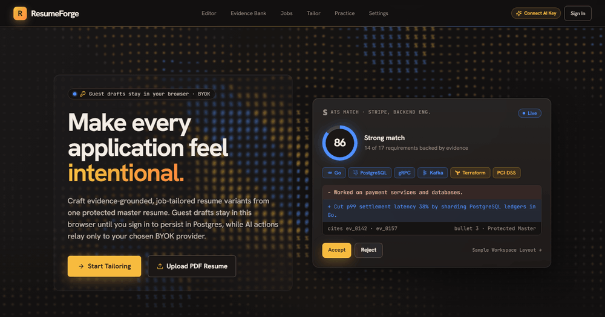
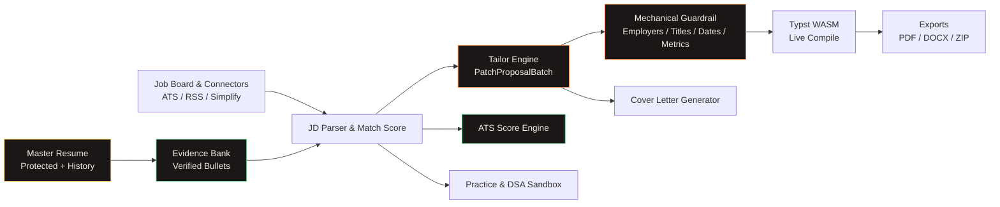

<div align="center">

# 🛠️ ResumeForge

**Self-hostable, BYOK AI workspace that creates evidence-grounded, job-specific resume variants from one protected master resume — plus job discovery, deterministic ATS scoring, application tracking, and interview prep.**

[](https://github.com/ZenzerJs/ResumeForge/actions/workflows/ci.yml)
[](https://nextjs.org/)
[](https://react.dev/)
[](https://www.typescriptlang.org/)
[](https://tailwindcss.com/)
[](https://www.prisma.io/)
[](https://typst.app/)
[](https://vitest.dev/)
[](LICENSE)

*Zero hallucination. Zero data leaks. Every resume bullet is a reviewable, evidence-backed patch.*



> Built after a season of silent rejections as a first-year. This tool carried my own search into a Google technical interview as a second-year.

</div>

---

## 📋 Table of Contents

- [Why ResumeForge](#-why-resumeforge)
- [Key Features](#-key-features)
- [Architecture](#-architecture)
- [Tech Stack](#-tech-stack)
- [Getting Started](#-getting-started)
- [Environment Variables](#-environment-variables)
- [Available Scripts & Testing](#-available-scripts--testing)
- [Deployment & Automation](#-deployment--automation)
- [Project Structure](#-project-structure)
- [Philosophy & Disclosure](#-philosophy--disclosure)

---

## 💡 Why ResumeForge

Most AI resume tools invent experience you don't have, or silently overwrite your master document. ResumeForge does neither:

| Problem with typical AI resume tools | How ResumeForge fixes it |
|---|---|
| ❌ LLM invents employers, seniority, dates, or metrics | ✅ **Mechanical guardrail** hard-blocks fabricated employers, inflated titles/dropped level markers, widened dates (ISO month-level containment, with year-level fallback when months are omitted), and inflated or subject-swapped metrics against your frozen Master Resume snapshot |
| ❌ Silent overwrites destroy your original resume | ✅ Your **Master Resume** is write-protected (`MasterHistory` pre-overwrite snapshots + undo); changes are reviewable patches written to isolated `ResumeVariant` records |
| ❌ Opaque third-party key storage | ✅ **Self-hostable, BYOK** — keys are encrypted with a non-extractable Web Crypto AES-GCM key in browser **IndexedDB** (`resumeforge-byok-vault`, with memory-only fallback); the app does not store or log request bodies or keys in Postgres |
| ❌ "ATS score" is just an LLM guess | ✅ **Deterministic scoring engine** (`evaluateAtsScore` + `calculateMatchScore`) with auditable, rule-based checks |

### 🚫 What ResumeForge refuses to do

- **Never auto-submits** an application. You press the button.
- **Never persists your API keys in the database.** Keys stay encrypted in browser IndexedDB (or are read from optional server environment variables when self-hosting); request bodies and keys are never logged.
- **Never invents experience.** If a job requirement has no matching evidence, you get an explicit *Gap*, not a made-up bullet. Unverified skills are flagged as soft warnings and require explicit per-skill acknowledgement before an AI patch can add them.
- **Never overwrites your master resume silently.** It is write-protected; every change is a server-validated, evidence-cited patch (`PatchProposalBatch` + `PatchCitation`), and exporting a tailored or AI-patched variant fails closed unless a frozen Master Resume snapshot exists.

---

## ✨ Key Features

<table>
<tr>
<td width="50%" valign="top">

### 📝 Typst Resume Editor & PDF Import (`/editor`)
- **Dual editing modes**: CodeMirror 6 Typst source editor and a **Guided Visual Form Builder** (`ResumeFormBuilder`) requiring no Typst syntax knowledge.
- **Live client-side compilation**: Instant SVG/PDF rendering via `typst.ts` WASM in the browser, plus optional AI Typst compile-error repair (`/api/ai/repair-typst`) and experimental source-backed layout mode (`NEXT_PUBLIC_RESUME_LAYOUT_V2`).
- **PDF import**: Upload an existing `.pdf` resume for deterministic text extraction (`pdf-parse` / `pdfjs-dist`) with optional BYOK AI structuring into Typst.
- **Multi-format export**: Export PDF, ATS-friendly **DOCX** (`docx`), plain text, `.typ` source, or a full **Application Package ZIP** with SHA-256 `manifest.json` integrity hashes.

### 🗂️ Master Resume & Evidence Bank (`/library`)
- Protected single source of truth storing verified `experience`, `project`, `skill`, `education`, `award`, and `metric` items with ordered, technology-tagged bullets.
- **Bulk PDF Dropzone** and AI extraction from your Master Resume to populate your Evidence Bank.

### 🤖 Tailor Engine & AI Assistant (`/tailor`)
- Five workspace views: **Overview**, **3-Pane**, **Job Info**, **Cover Letter**, and **Diagnostics**.
- **Server-bound patch batches**: Generates Zod-validated `PatchProposalBatch` proposals tied to `PatchCitation` records (`evidenceId` / `bulletId`), with rendered SVG suggestion previews (`suggestion-preview`) and deterministic one-click diagnostics.
- **Grounded Cover Letters**: Produces tailored cover letters strictly citing your Evidence Bank.
- **Read-only AI Assistant Chat**: Conversational assistant in the editor/tailor dock backed by allowlisted read-only inspection tools (`search_evidence`, `get_ats_score`, `get_resume_facts`, `run_guardrail`, `get_job`, `search_saved_jobs`, `inspect_layout_budget`).

</td>
<td width="50%" valign="top">

### 📊 Deterministic ATS Score & Landing Sandbox (`/`, `/tailor`)
- **100-point rule-based ATS rubric**: Evaluates base resume health (30 pts), required skill match (40 pts), preferred skill match (15 pts), and role-relevant evidence (15 pts) across six role profiles (`Full-stack`, `Backend`, `AI/LLM`, `ML`, `Frontend`, `Data/Platform`).
- **Evidence-grounded compatibility engine**: `calculateMatchScore` (with framework alias inference such as `Next.js -> React/TS`) plus an optional bounded AI qualitative reviewer and an interactive ATS Sandbox on `/`.

### 🧭 Job Discovery Board & Application Tracker (`/tracker`, `/tracker/feed`)
- **Multi-source job ingestion**: Connector orchestrator syncing **Greenhouse**, **Lever**, **Ashby**, **Adzuna CA**, **Jobicy**, **Remotive**, and **RemoteOK**, plus **Pitt CSC / SimplifyJobs** markdown sync (`/api/jobs/sync-pittcsc`) and URL/text JD extraction.
- **Discovery filters & blended match sorting**: Filter by source, workplace type, Canadian eligibility, city + km radius (`src/lib/geo/geocoding.ts`), posted-within window, salary, and minimum match tier.
- **Pipeline, Apply Sheet & Outcomes**: Track jobs across `SAVED`, `APPLIED`, `INTERVIEWING`, `OFFER`, and `REJECTED` (`/tracker/saved`, `/tracker/applied`), inspect per-variant interview rates and funnel metrics (`/tracker/outcomes`), and export guardrail-checked bundles from the **Apply Prep Sheet**.
- **Company Intelligence Dossiers**: Cached company interview styles, culture metrics, and `hiring-without-whiteboards` process notes (`seed:intel` + optional BYOK generation).

### 💻 Interview Prep Hub & DSA Code Sandbox (`/practice`)
- **Question Bank**: Curated **Algorithms (NeetCode 150)**, **System Design**, and **OA Screening** prompts with company tags, complexity bounds, discussion rubrics, STAR behavioral frameworks, and optional Tech-OA sync (`npm run sync:oa`).
- **Browser DSA Code Runner**: Executes **JavaScript** and **TypeScript** solutions inside an opaque-origin sandboxed iframe + Web Worker (`src/lib/dsa-runner.ts`), with JD-based problem recommendations, progressive hints, and a **Socratic Interview Coach & Complexity Scorecard**. *(Python 3 starter templates are shown in the editor, and the runner reports an explicit notice that Python execution requires a Python/Pyodide runtime.)*

</td>
</tr>
</table>

---

## 🏗️ Architecture



- **Guest vs. Signed-In Persistence**: Guest drafts stay in browser `localStorage` and can be migrated to PostgreSQL upon sign-up or login (`/api/auth/migrate-guest-drafts`). Authenticated sessions use HMAC-SHA256 signed `HttpOnly` `rf_session` cookies with `sessionVersion` revocation. Setting `DEMO_MODE=true` enables a bounded public demo mode (disables signup and keeps draft mutations browser-local).
- **BYOK & Network Security**: Typst WASM compilation and DSA JS/TS execution run client-side in isolated browser contexts. Browser BYOK calls to **OpenAI**, **Anthropic**, and **Groq** route through an authenticated same-origin relay (`/api/ai/byok-proxy`) restricted to allowlisted HTTPS endpoints; **Gemini** calls `generativelanguage.googleapis.com` directly; **Ollama** and **Custom** OpenAI-compatible endpoints run through the server gateway when self-hosting. Server-side outbound fetches use `safeFetch` with DNS-level private-IP/SSRF blocking (`src/lib/security/safe-fetch.ts`).

---

## 🧱 Tech Stack

| Layer | Technology |
|---|---|
| Framework | Next.js 15 (App Router) + React 19 + TypeScript (strict) |
| Styling & UI | Tailwind CSS 3 + shadcn/ui + Radix UI + Framer Motion + Lucide + `simple-icons` — **"Ember Ink"** studio design system (`Hanken Grotesk` & `JetBrains Mono`) |
| Database | PostgreSQL 16 via Prisma ORM 6 (`prisma/schema.prisma`) |
| Document Engine & Exports | Typst (`@myriaddreamin/typst.ts` WASM), `pdf-parse` / `pdfjs-dist`, `docx`, `jszip` |
| Code Editor | CodeMirror 6 (`@uiw/react-codemirror`) |
| AI Integration | Multi-provider gateway (`gemini`, `openai`, `anthropic`, `groq`, `ollama`, `custom`) — Zod 4 schema validation, Web Crypto AES-GCM IndexedDB vault, error/PII redaction |
| Testing | Vitest 4 + Testing Library (unit & PostgreSQL integration) + Playwright (E2E) |

---

## 🚀 Getting Started

### Prerequisites

- Node.js 22+ and npm
- Docker & Docker Compose (or a local PostgreSQL 16 instance)

### Option A: Local Development (Postgres in Docker + Next.js dev server)

<details>
<summary><strong>1. Clone and install dependencies</strong></summary>

```bash
git clone https://github.com/ZenzerJs/ResumeForge.git
cd ResumeForge
npm install
```

`postinstall` automatically copies the `pdfjs-dist` worker assets into `public/workers`.
</details>

<details>
<summary><strong>2. Configure environment variables</strong></summary>

```bash
cp .env.example .env
```

Update the `change-me-*` values in `.env` (`POSTGRES_PASSWORD`, `DATABASE_URL`, `APP_ACCESS_SECRET`, `JOB_SYNC_SECRET`). See [Environment Variables](#-environment-variables) for full details.
</details>

<details>
<summary><strong>3. Start Postgres, apply migrations, and seed sample evidence</strong></summary>

```bash
docker compose up -d postgres
npx prisma migrate deploy
npx prisma db seed
```

`docker compose up -d postgres` starts PostgreSQL 16 on `127.0.0.1:${POSTGRES_PORT:-5432}` using the `POSTGRES_*` credentials from `.env`. `npx prisma db seed` is idempotent and inserts sample `EvidenceItem` and `Bullet` records.

Optional data seeds for job intel and OA questions:

```bash
npm run seed:intel
npm run sync:oa
```
</details>

<details>
<summary><strong>4. Start the development server</strong></summary>

```bash
npm run dev
```

Open [http://localhost:3000](http://localhost:3000) in your browser.
</details>

### Option B: Full-Stack Docker Compose

After copying `.env.example` to `.env` and replacing every `change-me-*` placeholder:

```bash
docker compose up --build -d
```

This builds the multi-stage `Dockerfile` (Node 22 Alpine), waits for `postgres` healthcheck, runs `npx prisma migrate deploy`, and serves the app on `${APP_BIND_ADDRESS:-127.0.0.1}:${APP_PORT:-3000}`.

---

## 🔐 Environment Variables

All environment variables read by the codebase are declared and verified by `npm run check:env` against `.env.example`.

| Variable | Required | Purpose |
|---|---|---|
| `POSTGRES_USER`, `POSTGRES_PASSWORD`, `POSTGRES_DB`, `POSTGRES_PORT` | Compose | PostgreSQL 16 container credentials and port (`5432` default) |
| `DATABASE_URL` | Yes | PostgreSQL connection string (`postgresql://...`) |
| `APP_ACCESS_SECRET` | Yes | Signs `rf_session` HMAC-SHA256 cookies (min 8 chars; not a login password) |
| `APP_ACCESS_PASSWORD` | Optional | Shared-password fallback for session checks; leave empty for standard signup/login |
| `JOB_SYNC_SECRET` | Sync/Cleanup | Bearer token protecting `POST /api/jobs/sync-pittcsc`, `/api/jobs/cleanup`, and `/api/connectors/sync` |
| `JOB_BOARD_MAX_AGE_DAYS` | Optional | Job board expiry threshold (`30` or `60`, defaults to `60`) |
| `NEXT_PUBLIC_APP_URL` | Yes (prod) | Public origin without trailing path (determines `Secure` cookie flag via `https://`) |
| `DEMO_MODE` | Optional | `true` enables bounded public demo mode (`false` for self-hosted persistence) |
| `TRUST_PROXY` | Optional | Set `true` only behind a reverse proxy that overwrites `x-forwarded-for` / `x-real-ip` |
| `ALLOWED_IMPORT_HOSTS`, `SIMPLIFY_JOBS_URL` | Optional | Extra allowlisted hosts for Tier 1 bulk-import `sourceUrl`, or override SimplifyJobs markdown URL |
| `ADZUNA_APP_ID`, `ADZUNA_APP_KEY`, `INDEED_MCP`, `INDEED_PARTNER_KEY` | Optional | Optional job board connector / fetcher credentials |
| `OPENAI_API_KEY`, `ANTHROPIC_API_KEY`, `GEMINI_API_KEY`, `GROQ_API_KEY`, `OLLAMA_BASE_URL`, `CUSTOM_OPENAI_*` | Optional | Server-side AI fallbacks (and `*_BASE_URL` overrides); the browser BYOK vault never reads these |
| `NEXT_PUBLIC_DEFAULT_AI_PROVIDER`, `NEXT_PUBLIC_DEFAULT_AI_MODEL` | Optional | Fallback provider/model labels read by the Typst repair route |
| `NEXT_PUBLIC_RESUME_LAYOUT_V2` | Optional | Set `true` to enable the experimental source-backed resume layout |

---

## 📜 Available Scripts & Testing

| Command | Description |
|---|---|
| `npm run dev` | Start the Next.js development server |
| `npm run build` | Generate Prisma Client (`prisma generate`) and build for production (`next build`) |
| `npm run start` | Start the production server bound to `0.0.0.0` (`next start -H 0.0.0.0`) |
| `npm run lint` | Run ESLint (`next lint`) |
| `npm run typecheck` | Run TypeScript typechecking (`tsc --noEmit`) |
| `npm run test` | Run the Vitest unit/mocked test suite (`tests/`, excluding `tests/integration/**` and `e2e/**`) |
| `npm run test:integration` | Run PostgreSQL contract tests (`tests/integration/**`) inside an isolated, disposable `rf_it_*` schema |
| `npm run check:env` | Fail if code reads a `process.env` name missing from `.env.example` |
| `npm run generate:fixtures` | Regenerate the synthetic PDF test fixture (`e2e/fixtures/sample-resume.pdf`) |
| `npm run test:e2e` | Run the Playwright E2E suite (`playwright.config.ts`; set `PLAYWRIGHT_SCREENSHOTS=true` to include gallery specs) |
| `npm run test:e2e:ui` | Launch Playwright E2E runner in interactive UI mode |
| `npm run sync:oa` | Sync OA interview problems from the public `Tech-OA-Interview-Questions` markdown table into `InterviewProblem` |
| `npm run seed:intel` | Seed `CompanyDossier` records from `hiring-without-whiteboards` |
| `npm run normalize:jobs` | Backfill/normalize stored `Job` descriptions in PostgreSQL |

<!-- TODO: Check whether additional E2E specs in e2e/ should be documented alongside playwright.demo.config.ts and playwright.release.config.ts. -->
Additional Playwright configurations exist for demo-mode render verification (`playwright.demo.config.ts`, used in CI) and full release-journey verification (`scripts/run-release-e2e.ts` with `playwright.release.config.ts`).

---

## 🚢 Deployment & Automation

- **Render Blueprint (`render.yaml`)**: Provisions a Node 22 `web` service (`npm ci && npx prisma generate && npx prisma migrate deploy && npm run build`, health check at `/login`) alongside a PostgreSQL 16 database (`resumeforge-db`), auto-generating `APP_ACCESS_SECRET` and `JOB_SYNC_SECRET`.
- **Docker (`Dockerfile`, `docker-compose.yml`)**: Multi-stage Node 22 Alpine container that binds `0.0.0.0:3000` and runs `npx prisma migrate deploy && npm start`.
- **GitHub Actions (`.github/workflows/`)**:
  - `ci.yml`: Runs `actionlint`, conflict-marker check, `npm run check:env`, `prisma migrate deploy`, `typecheck`, `lint`, `test`, `test:integration`, `build` (with `NEXT_PUBLIC_RESUME_LAYOUT_V2=true`), and Playwright V2 resume render verification.
  - `ingest-jobs.yml`: Scheduled daily sync of SimplifyJobs internship listings into `POST /api/jobs/sync-pittcsc`.
  - `job-expiry.yml`: Scheduled daily dry-run expiry audit against `POST /api/jobs/cleanup`.

---

## 📁 Project Structure

```
ResumeForge/
├── src/
│   ├── app/            # Next.js App Router pages (/editor, /library, /tracker, /tailor, /practice, /settings, /login) & /api/* routes
│   ├── components/     # UI modules — editor/, tailor/, tracker/, interview/, practice/, evidence/, landing/, settings/, design-system/
│   └── lib/            # Guardrail, facts engine, ATS evaluator, BYOK vault, AI gateway/tools, connectors, ingestion, DSA sandbox, security
├── packages/
│   ├── core/src/       # Shared deterministic logic — scoring/ (calculateMatchScore), intel/
│   └── schema/src/     # Shared Zod schemas & types
├── prisma/             # PostgreSQL schema, migrations, and seed.ts
├── prompts/            # AI prompt templates and specifications
├── scripts/            # Env parity, Postgres integration runner, release E2E runner, seed/sync utilities
├── tests/ & e2e/       # Vitest unit/integration suites and Playwright E2E suites
├── Dockerfile & docker-compose.yml
├── render.yaml         # Render Blueprint (web service + Postgres 16)
├── DESIGN.md           # Design system reference
├── PRODUCT.md          # Product spec
├── SECURITY.md         # Threat model and security controls
└── AGENTS.md           # AI-agent working agreements for this repo
```

---

## 🎓 Philosophy & Disclosure

> **Truthfulness over persuasion.**

The AI never invents experience — it only rephrases, restructures, or highlights what already exists in your verified Evidence Bank. Every AI-assisted change is a **diffable, reviewable patch**, and every score or recommendation traces back to a concrete, auditable reason.

*Developed with AI coding assistants (Cursor, Antigravity). The author designed the architecture, product spec and guardrail policy, and reviews and validates changes.*

<div align="center">

*Built by [@ZenzerJs](https://github.com/ZenzerJs) · [MIT License](LICENSE)*

</div>
