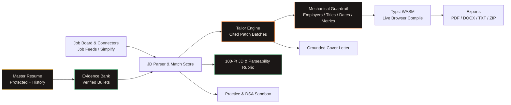

<div align="center">

#  ResumeForge

**Local-first, BYOK resume tailoring built first for SWE and technical internship applicants.**
Tailor a protected Master Resume to each job description with cited diffs, a deterministic JD & parseability rubric (inspired by [HackerRank's open-source `hiring-agent`](https://github.com/interviewstreet/hiring-agent)), and browser Typst WASM single-page PDFs.

[](https://github.com/ZenzerJs/ResumeForge/actions/workflows/ci.yml)
[](https://nextjs.org/)
[](https://react.dev/)
[](https://www.typescriptlang.org/)
[](https://www.prisma.io/)
[](https://typst.app/)
[](https://vitest.dev/)
[](LICENSE)

[ **Watch Walkthrough**](#video-walkthrough) · [ **How It Works**](#how-it-works) · [ **Workspace**](#the-workspace) · [ **Architecture**](#architecture--security) · [ **Quick Start**](#getting-started)

<br />


*Tailor your resume. Keep every claim true. Local-first · Bring your own AI key · Open source.*

</div>

---

##  How It Works

ResumeForge treats resume tailoring like version-controlled software engineering—built around a single truthful loop:

1. **Store verified evidence (`/library`):** Keep your own resumes, class/personal projects, hackathon writeups, and public repos in an Evidence Bank alongside a write-protected Master Resume.
2. **Check against a real job description (`/tailor`):** Run a deterministic 100-point JD & parseability check (inspired by [HackerRank's `hiring-agent`](https://github.com/interviewstreet/hiring-agent), with zero LLM score variance and measured Typst page fit), plus an optional qualitative AI review.
3. **Review cited patches & explicit gaps:** Every AI suggestion is a diff tied to verified Evidence Bank IDs. Skills missing from your Evidence Bank surface as explicit **Gaps**—never fabricated bullets or inflated metrics.
4. **Export a crisp 1-page PDF (`/editor`):** Compile live in the browser via Typst WASM, or export DOCX, unwrapped plain text, `.typ` source, or a guardrail-checked ZIP bundle.

---

##  Video Walkthrough

Watch the full flow—blocked unverified claims, explicit skill gaps, cited diff approval, and 1-page Typst PDF export:

<div align="center">

https://github.com/user-attachments/assets/b40e9714-eea7-4e09-845f-0d223697b5d8

</div>

---

##  Why ResumeForge?

Most AI resume builders invent experience you can't defend in an interview, nag you to invent fake percentages, or silently overwrite your master resume.

| Typical AI Resume Tools | ResumeForge |
| :--- | :--- |
|  **Invents employers, titles, or fake `%` metrics** |  **Mechanical Guardrail & Cited Patches** — blocks unverified employers, inflated titles, widened dates, and unbacked metrics against your frozen Master snapshot (exports fail closed if no snapshot exists). |
|  **Silently overwrites your base resume** |  **Write-Protected Master + Isolated Variants** — pre-overwrite `MasterHistory` snapshots, undo, and diffable per-job `ResumeVariant` proposals. |
|  **Random LLM "ATS scores" & metric nagging** |  **Deterministic 100-Pt JD & Parseability Rubric** — 0 score variance, measured Typst page fit, anti-hidden-text checks, and concrete engineering specificity without forcing `%` metrics. |
|  **Opaque SaaS lock-in & server-stored keys** |  **Local-First & Browser-Encrypted BYOK** — non-extractable Web Crypto AES-GCM key in IndexedDB (never stored in Postgres), or run locally with **Ollama** for zero external AI calls. |

**Concrete example (what ResumeForge refuses to do):**
* *Generic AI rewrite:* turns `"Built REST API endpoints for a class scheduling app"` into `"Increased team productivity by 17.7% across Agile SDLC workflows"` — an unverifiable vanity metric an interviewer will immediately pick apart.
* *ResumeForge patch:* rewrites strictly from your cited Evidence Bank bullet (`evid-01`), flags unbacked JD requirements (e.g., `Kubernetes`) as an explicit **Gap**, and uses optional qualitative review to warn against suspicious vanity metrics while enforcing fairness guardrails (ignoring name, school prestige, GPA, and location).

### What This Is (and Isn't)
* **Built first for SWE & technical internships:** That is why internship job feeds and a browser coding sandbox sit alongside the resume editor (scope will widen over time).
* **Not an employer ATS or auto-apply bot:** The rule-based rubric checks structure, single-page fit, and JD requirement coverage—it does not claim to predict recruiter hiring decisions, and you review and submit every application yourself.
* **Hosted site is a demo; local-first is the intended setup:** Clone and run locally on your own machine with your own AI key or **Ollama**.
* **No employer IP & honest AI retention:** Store only your own resumes, public repos, and non-proprietary project notes—never confidential employer code. Cloud AI keys still send prompts to your chosen provider under their retention policy; use **Ollama** locally for zero external AI requests.

---

##  The Workspace

ResumeForge is organized around a **Core Tailoring Loop** plus **Supporting SWE Internship Tools** (alongside `/settings` for BYOK/account management and `/login` for authentication):

### Core Tailoring Loop

#### 1.  Typst Resume Editor & PDF Import (`/editor`)
* **Dual Editing Modes:** Switch seamlessly between a CodeMirror 6 Typst source editor and a **Guided Visual Form Builder** (`ResumeFormBuilder`, zero Typst syntax required).
* **Instant Client-Side Compilation:** Live SVG/PDF preview compiled directly in the browser via `typst.ts` WASM, with measured page-count checks and one-click AI syntax repair (`/api/ai/repair-typst`) if a compile error occurs.
* **PDF Import & Multi-Format Export:** Extract existing `.pdf` resumes into Typst (`pdf-parse` / `pdfjs-dist`, with optional BYOK structuring), and export to PDF, parsable **DOCX** (`docx`), unwrapped plain text (`.txt`), `.typ` source, or a full **Application Package ZIP** (`jszip`) with a SHA-256 `manifest.json`.

#### 2.  Master Resume & Evidence Bank (`/library`)
* **Single Source of Truth:** Store verified `experience`, `project`, `skill`, `education`, `award`, and `metric` items with technology-tagged bullets, plus explicit Draft → Verified promotion.
* **Bulk Ingestion & Extraction:** Drag-and-drop past resume PDFs into the **Bulk PDF Dropzone** to deterministically extract and index historical achievements into reusable evidence records, or extract draft items directly from your Master Typst source.

#### 3.  Evidence-Grounded Tailor Engine (`/tailor`)
* **5 Specialized Views:** Switch between **Overview**, **3-Pane**, **Job Info**, **Cover Letter**, and **Diagnostics**.
* **Server-Validated Patch Batches:** Every AI suggestion in a `PatchProposalBatch` is Zod-validated and linked to a `PatchCitation` (`evidenceId` and/or `bulletId`), complete with rendered SVG suggestion previews and grounded cover letter generation. Unverified skills emit soft warnings and require explicit per-skill acknowledgement before an AI patch can add them.
* **Read-Only Inspection Assistant:** Chat with a docked/floating AI assistant (`/api/ai/chat`) equipped with allowlisted read-only inspection tools (`search_evidence`, `get_ats_score`, `get_resume_facts`, `run_guardrail`, `get_job`, `search_saved_jobs`, `inspect_layout_budget`) that inspect without mutating your document.

### Supporting SWE Internship Tools

#### 4.  Deterministic JD Rubric & Job Tracker (`/tracker`)
* **100-Point Rule-Based Check (Not an Employer ATS):** `evaluateAtsScore` audits Base Health (`30 pts` — measured Typst page fit, standard headings, working links, concrete engineering specificity without forcing `%` metrics, and anti-hidden-text checks), Required Skills (`40 pts`), Preferred Skills (`15 pts`), and Role Evidence (`15 pts`) across `Full-stack`, `Backend`, `AI/LLM`, `ML`, `Frontend`, and `Data/Platform` profiles. Alongside it, `calculateMatchScore` computes Evidence-Bank compatibility with framework alias inference (e.g., `Next.js → React / JavaScript / TypeScript`), and `/` includes an interactive score sandbox.
* **Multi-Source Job Discovery (`/tracker/feed`):** Syncs listings from **Greenhouse, Lever, Ashby, Adzuna CA, Jobicy, Remotive, RemoteOK**, and **Pitt CSC / SimplifyJobs**, complete with Canadian eligibility, city radius, salary, and blended match-tier filters.
* **Funnel Analytics & Company Dossiers:** Track applications across `SAVED → APPLIED → INTERVIEWING → OFFER / REJECTED` (plus `ARCHIVED`), analyze per-variant conversion rates in `/tracker/outcomes`, export guardrail-checked bundles from the Apply Prep Sheet, and browse cached company interview dossiers (`hiring-without-whiteboards` seed + optional BYOK generation).

#### 5.  Interview Prep & Browser DSA Sandbox (`/practice`)
* **Curated Problem Bank:** Practice **NeetCode 150**, **System Design**, and **OA Screening** questions (`ALL_QUESTIONS`), plus company-linked `InterviewProblem` records synced via `npm run sync:oa`, filterable by target company and JD requirements.
* **Sandboxed Code Runner:** Execute **JavaScript** and **TypeScript** solutions inside an isolated Web Worker + opaque-origin sandboxed iframe (`src/lib/dsa-runner.ts`), paired with progressive hints, a **Socratic Interview Coach**, and a complexity scorecard (uses BYOK when configured, with a deterministic heuristic fallback). *Python 3 starter templates are included in the editor; executing Python reports an explicit notice that a Python/Pyodide runtime is required.*

---

##  Architecture & Security



* **Local-First & Authenticated Modes:** Try the workspace immediately in the browser (`localStorage` guest drafts with guided migration to PostgreSQL upon sign-up/login via `/api/auth/migrate-guest-drafts`), or deploy in bounded public `DEMO_MODE`. Signed-in sessions use HMAC-SHA256 `HttpOnly` `rf_session` cookies with `sessionVersion` revocation.
* **Browser-Encrypted BYOK Vault:** API keys for **OpenAI, Anthropic, Gemini, Groq, Ollama**, or custom endpoints are encrypted in browser IndexedDB (`resumeforge-byok-vault` using a non-extractable Web Crypto AES-GCM key, with memory-only fallback). Keys are never persisted in PostgreSQL and are scrubbed from application error messages (`sanitizeError`). Browser requests to OpenAI, Anthropic, and Groq route through an authenticated same-origin relay (`/api/ai/byok-proxy`) restricted to allowlisted HTTPS endpoints, while server-mediated AI routes (`/api/ai/*`) receive the active `providerConfig` in memory to execute completions without logging keys or bodies in the app (hosting providers may still record standard HTTP metadata). Outbound server fetches enforce DNS-level private-IP/SSRF blocking (`safeFetch`).

---

##  Tech Stack

| Layer | Technology |
| :--- | :--- |
| **Framework** | Next.js 15 (App Router), React 19, TypeScript (Strict) |
| **UI & Design System** | Tailwind CSS 3, shadcn/ui, Radix UI, Framer Motion, Lucide, `simple-icons` — *"Ember Ink"* theme (`Hanken Grotesk` & `JetBrains Mono`) |
| **Database** | PostgreSQL 16 + Prisma ORM 6 |
| **Document & PDF Engine** | Typst (`@myriaddreamin/typst.ts` WASM), CodeMirror 6, `pdf-parse`, `pdfjs-dist`, `docx`, `jszip` |
| **AI & Validation** | Multi-provider gateway (`gemini`, `openai`, `anthropic`, `groq`, `ollama`, `custom`), Zod 4, Web Crypto Vault |
| **Testing & CI** | Vitest 4 (Unit + Isolated Postgres Schema Integration), Playwright (E2E + Visual Render Verification) |

---

##  Getting Started

### Option A: One-Line Local Install (Recommended — Docker Only)

No `git clone`, no Node.js install, and no manual `.env` editing required. Install and start [Docker Desktop](https://docs.docker.com/get-docker/) (or Docker Engine with Compose v2), then run **one command**:

**Windows (PowerShell):**
```powershell
irm https://raw.githubusercontent.com/ZenzerJs/ResumeForge/main/install.ps1 | iex
```

**macOS / Linux (Terminal):**
```bash
curl -fsSL https://raw.githubusercontent.com/ZenzerJs/ResumeForge/main/install.sh | bash
```

What happens automatically:
* Downloads `docker-compose.yml` into `~/resumeforge` (or uses the current repo directory if run inside a clone).
* Checks local ports (`3000` and `5432`) and picks free ports automatically if already in use.
* Generates cryptographically random secrets into `.env` on first run (never overwrites an existing `.env`).
* Pulls the prebuilt multi-arch image (`ghcr.io/zenzerjs/resumeforge:latest`), starts PostgreSQL 16 + ResumeForge, runs Prisma migrations, and opens `http://localhost:3000`.
* Re-run the exact same command anytime to update while preserving your PostgreSQL data (`resumeforge_pgdata`).

> **Manage your local instance:** Stop with `docker compose -f ~/resumeforge/docker-compose.yml down` (or `.\install.ps1 -Down` / `./install.sh --down`) and view logs with `docker compose -f ~/resumeforge/docker-compose.yml logs -f app`.

### Option B: Local Development (Node.js 22 + PostgreSQL 16)

Prerequisites: **Node.js 22+**, `npm`, and **Docker & Docker Compose** (or a local PostgreSQL 16 instance).

```bash
# 1. Clone and install dependencies (auto-copies pdfjs worker assets)
git clone https://github.com/ZenzerJs/ResumeForge.git
cd ResumeForge
npm install

# 2. Configure environment variables (update the 'change-me-*' secrets)
cp .env.example .env

# 3. Start PostgreSQL 16, run migrations, and seed sample evidence
docker compose up -d postgres
npx prisma migrate deploy
npx prisma db seed

# 4. (Optional) Seed company intel dossiers and OA interview questions
npm run seed:intel
npm run sync:oa

# 5. Launch the workspace at http://localhost:3000
npm run dev
```

### Option C: Build Docker Image from Source

Inside a cloned repository, pass `-Build` / `--build` to the installer (or run Compose directly after creating `.env`):

```powershell
# Windows PowerShell
.\install.ps1 -Build
```

```bash
# macOS / Linux
./install.sh --build
```

```bash
# Or directly with Compose after copying .env.example -> .env
docker compose up --build -d
```

Builds the multi-stage Next.js `standalone` Node 22 Alpine image, waits for the `postgres` healthcheck, runs `prisma migrate deploy`, and serves the app at `http://127.0.0.1:3000` (configurable via `APP_BIND_ADDRESS` and `APP_PORT`).

---

##  Configuration & Reference

<details>
<summary> <strong>Environment Variables (Click to expand)</strong></summary>

<br />

All environment variables read by the codebase are verified via `npm run check:env` against `.env.example`.

| Variable | Required | Purpose |
| :--- | :--- | :--- |
| `POSTGRES_USER`, `POSTGRES_PASSWORD`, `POSTGRES_DB`, `POSTGRES_PORT` | Compose | PostgreSQL 16 container credentials and port (`5432` default) |
| `APP_PORT`, `APP_BIND_ADDRESS` | Compose | App host port (`3000`) and bind address (`127.0.0.1` default) |
| `DATABASE_URL` | **Yes** | PostgreSQL connection string (`postgresql://...`) |
| `APP_ACCESS_SECRET` | **Yes** | Signs `rf_session` HMAC-SHA256 cookies (min 8 chars; not a login password) |
| `APP_ACCESS_PASSWORD` | Optional | Shared-password fallback; leave empty for standard signup/login |
| `JOB_SYNC_SECRET` | Sync/Cleanup | Bearer token protecting `POST /api/jobs/sync-pittcsc`, `/api/jobs/cleanup`, and `/api/connectors/sync` |
| `JOB_BOARD_MAX_AGE_DAYS` | Optional | Job board expiry threshold (`30` or `60`, defaults to `60`) |
| `NEXT_PUBLIC_APP_URL` | **Yes (Prod)** | Public origin without trailing path (determines `Secure` cookie flag) |
| `DEMO_MODE` | Optional | `true` enables bounded public demo mode (browser-local mutations, disables signup) |
| `TRUST_PROXY` | Optional | Set `true` behind a reverse proxy that overwrites `x-forwarded-for` / `x-real-ip` |
| `ALLOWED_IMPORT_HOSTS`, `SIMPLIFY_JOBS_URL` | Optional | Extra allowlisted hosts for bulk import `sourceUrl` or custom SimplifyJobs URL |
| `ADZUNA_APP_ID`, `ADZUNA_APP_KEY`, `INDEED_MCP`, `INDEED_PARTNER_KEY` | Optional | Optional job board connector / fetcher credentials |
| `OPENAI_API_KEY`, `ANTHROPIC_API_KEY`, `GEMINI_API_KEY`, `GROQ_API_KEY`, `OLLAMA_BASE_URL`, `CUSTOM_OPENAI_*` | Optional | Server-side AI fallbacks (plus `*_BASE_URL` overrides) when self-hosting (never read by browser vault) |
| `NEXT_PUBLIC_DEFAULT_AI_PROVIDER`, `NEXT_PUBLIC_DEFAULT_AI_MODEL` | Optional | Fallback provider/model labels for the Typst repair route |
| `NEXT_PUBLIC_RESUME_LAYOUT_V2` | Optional | Set `true` to enable experimental source-backed resume layout |

</details>

<details>
<summary> <strong>Available Scripts & Testing (Click to expand)</strong></summary>

<br />

| Command | Description |
| :--- | :--- |
| `npm run dev` | Start the Next.js development server |
| `npm run build` | Generate Prisma Client and build for production |
| `npm run start` | Start the production server bound to `0.0.0.0` |
| `npm run lint` / `npm run typecheck` | Run ESLint and strict TypeScript verification (`tsc --noEmit`) |
| `npm run test` | Run the Vitest unit/mocked test suite (`tests/`) |
| `npm run test:integration` | Run PostgreSQL contract tests inside an isolated, disposable `rf_it_*` schema |
| `npm run test:e2e` / `npm run test:e2e:ui` | Run Playwright E2E suite (`playwright.config.ts`) or launch interactive UI mode |
| `npm run check:env` | Verify parity between `process.env` references and `.env.example` |
| `npm run generate:fixtures` | Regenerate the synthetic PDF test fixture (`e2e/fixtures/sample-resume.pdf`) |
| `npm run sync:oa` | Sync OA problems from `Tech-OA-Interview-Questions` into Postgres |
| `npm run seed:intel` | Seed `CompanyDossier` records from `hiring-without-whiteboards` |
| `npm run normalize:jobs` | Backfill/normalize stored `Job` descriptions in PostgreSQL |

Additional Playwright configs exist for demo-mode render verification (`playwright.demo.config.ts`, run in CI) and release-journey verification (`scripts/run-release-e2e.ts` with `playwright.release.config.ts`).

</details>

<details>
<summary> <strong>Project Structure & Deployment (Click to expand)</strong></summary>

<br />

```text
ResumeForge/
├── src/
│   ├── app/            # Next.js App Router (/editor, /library, /tracker, /tailor, /practice, /settings, /login) & /api/*
│   ├── components/     # Modular UI — editor/, tailor/, tracker/, interview/, practice/, evidence/, landing/, settings/, design-system/
│   └── lib/            # Mechanical guardrail, facts engine, JD & parseability rubric, BYOK vault, AI gateway, connectors, DSA sandbox
├── packages/
│   ├── core/src/       # Shared deterministic scoring (calculateMatchScore) & company intel logic
│   └── schema/src/     # Shared Zod 4 schemas & TypeScript contracts
├── prisma/             # PostgreSQL schema, migrations, and idempotent seed.ts
├── prompts/            # Grounded AI system prompt templates
├── scripts/            # Env parity checker, isolated Postgres test runner, release E2E runner, sync utilities
└── tests/ & e2e/       # Vitest unit/integration suites and Playwright E2E specs
```

**Deployment & CI Automation:**
* **Render Blueprint (`render.yaml`):** Provisions a Node 22 web service (`npm ci && npx prisma generate && npx prisma migrate deploy && npm run build`) + PostgreSQL 16 database (`resumeforge-db`).
* **GitHub Actions (`.github/workflows/`):** Automated CI pipeline (`ci.yml` running `actionlint`, conflict-marker check, `check:env`, `prisma migrate deploy`, `typecheck`, `lint`, `test`, `test:integration`, `build` with `NEXT_PUBLIC_RESUME_LAYOUT_V2=true`, and Playwright V2 resume render verification), plus daily cron workflows for SimplifyJobs ingestion (`ingest-jobs.yml`) and dry-run expired job audits (`job-expiry.yml`).

</details>

---

##  Philosophy & Disclosure

> **Truthfulness over persuasion.**

The AI never invents experience—it only rephrases, restructures, or highlights what already exists in your verified Evidence Bank. Every AI-assisted change is a **diffable, reviewable patch**, and every score or recommendation traces back to a concrete, auditable rule.

*Developed alongside AI coding assistants (Cursor, Antigravity). Architecture, product specification ([`PRODUCT.md`](PRODUCT.md)), design system ([`DESIGN.md`](DESIGN.md)), and security threat model ([`SECURITY.md`](SECURITY.md)) designed by [@ZenzerJs](https://github.com/ZenzerJs).*

<div align="center">

*Built & Designed by [@ZenzerJs](https://github.com/ZenzerJs) · [MIT License](LICENSE)*

</div>
